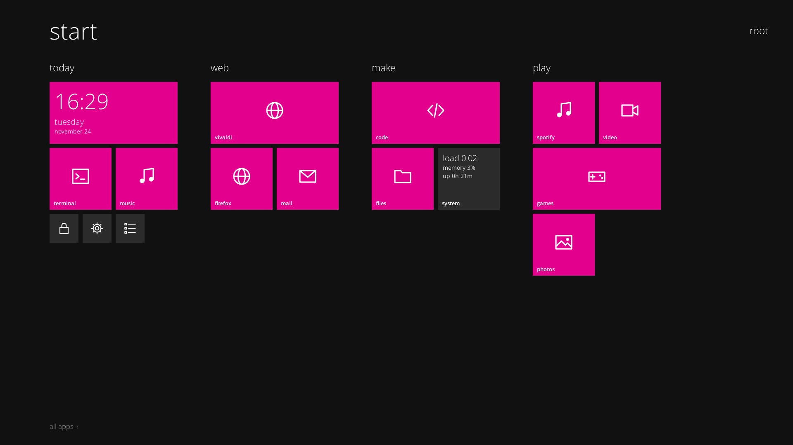
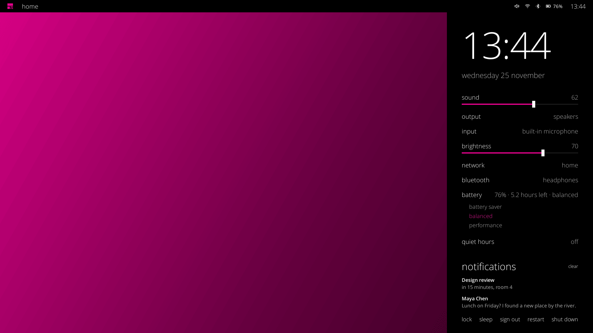
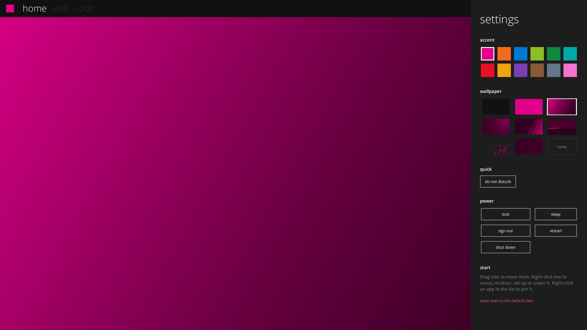
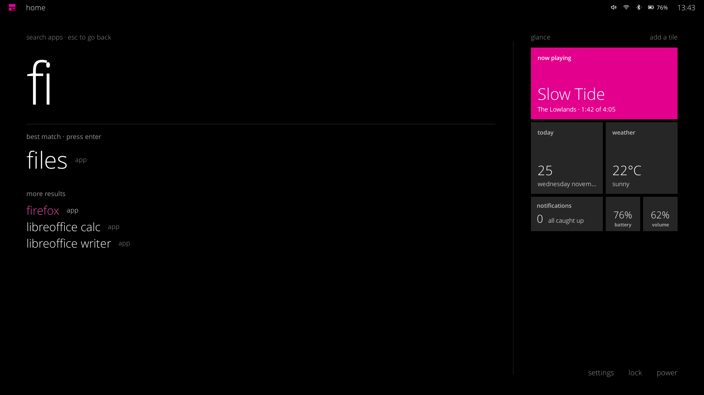
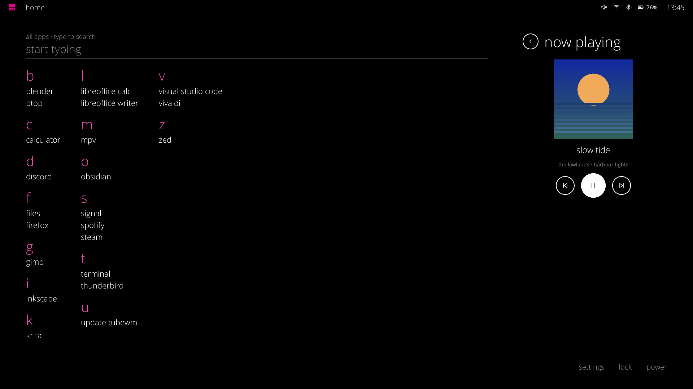
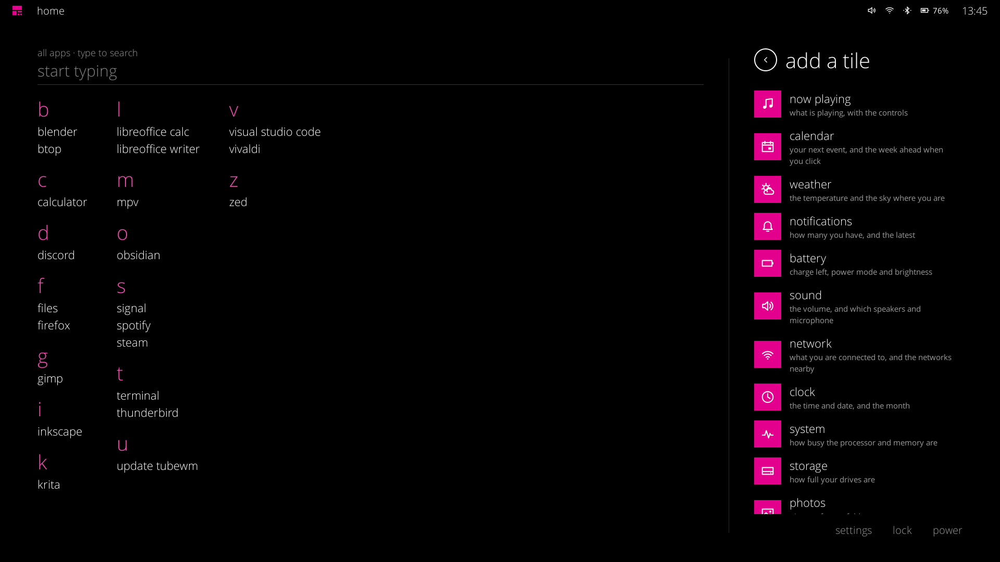
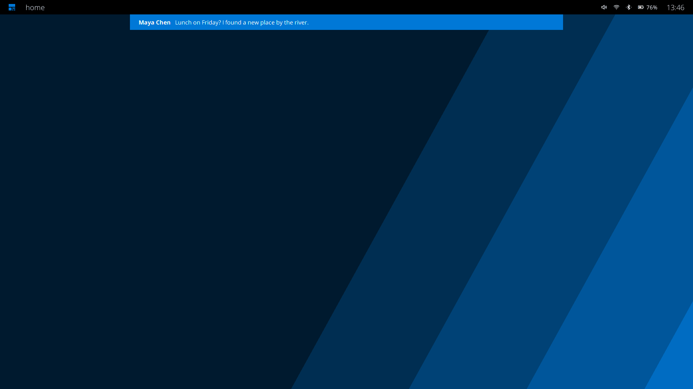
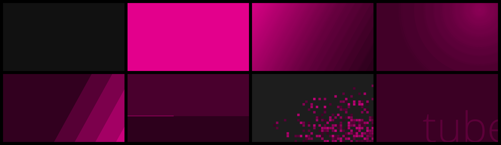

# tubewm

A flat, typographic Wayland desktop inspired by the Metro / Zune design language:
big lowercase headers, solid colour tiles, every app listed a to z, and a single
accent colour shared by the desktop and your apps. It runs on Wayfire and is
made to be used with the mouse first; keys are extras.



| | |
|---|---|
|  |  |
|  |  |
|  |  |

* [`desktop/`](desktop/README.md): the desktop itself. Start with live tiles,
  self-managing desktops, Metro title bars, the panel under the time,
  settings, notifications, a lock screen, screenshots, wallpapers and GTK
  styling.
* [`apps/`](apps/README.md): themes for VS Code, Vivaldi, Firefox, terminals,
  editors and more, all following the same accent.
* `palette/`: the shared colour palette that every part reads from.

All fonts are open (Open Sans, plus JetBrains Mono for code), and all glyphs
and artwork are drawn for this project.

## What you get

* **Start.** Tap the Windows key on its own, or click the start mark (a
  little cluster of tiles in your accent colour) at the left of the strip.
  Start stays ready in the background, so it opens the moment you press the
  key. Every app is listed from a to z in columns. Just type: the best match
  comes up first, Up and Down move through the rest, and Enter opens the one
  that's highlighted. On the right is the glance: live tiles you arrange
  yourself. Drag a tile to move it, drag its corner to make it any size,
  right-click for shapes, colour, settings and remove, and pick **add a tile**
  for the library (now playing, calendar, weather, notifications, battery,
  sound, network, clock, system, storage, photos, recent files, open windows,
  note, command and shortcut). Click a tile for its applet: play, pause and
  skip for whatever is playing, the week ahead, the sound devices and so on.
  Settings, lock and power sit at the bottom.
* **Windows** open filling the screen, with a thin flat title strip and a
  square Metro close button that turns red under the mouse. Drag a title to a
  side for half the screen, a corner for a quarter, or the middle to fill it.
  New windows take free space, or the desktop is retiled so nothing is
  covered; close one and its neighbours grow into the space it left. Full screen is only for when an app asks (F11, a video's
  button): the strip slides away and nothing else moves.
* **Desktops look after themselves.** There is always a spare `+` at the end
  of the strip. Open something there and it becomes a desktop named after it
  (`web`, `code`, `music`…); leave one empty and it goes away. Right-click a
  name to rename, keep, move or close it.
* **The panel under the time.** Sound, network, bluetooth (while it's on) and
  battery sit beside the time; click any of them for one panel with volume
  and brightness, speakers and microphones, network, bluetooth, battery,
  quiet hours, your last notifications, and lock, sleep, sign out, restart
  and shut down. Click **network** for the wi-fi networks around you, to
  switch or join one. Click **bluetooth** to turn it on or off, connect a
  device you've paired or pair a new one. Click **battery** to pick battery
  saver, balanced or performance.
* **Settings** is one app, full screen on true black: personalise (accent
  and wallpaper), start, notifications, network and devices. `Super+I`,
  start's settings, the settings tile and the charms all open it.
* **Notifications** come in as a band across the top and go away after a few
  seconds. Volume and brightness show a small bar at the bottom, whatever
  changed them: the panel, the Fn keys, a headset's buttons or an app.
* **Screenshots.** `Print` (or `Super+Shift+S`) holds the screen still, dims it
  and lets you choose an area, a window or a whole screen. `Shift+Print` takes
  the whole screen straight away. Pictures are saved to
  `~/Pictures/Screenshots` and copied.
* **The lock screen** shows your wallpaper, a big clock and the date, your name
  and the password box, with sleep, restart and shut down along the bottom.
  Where the login manager allows it, the people icon opens the sign-in screen
  so someone else can start their own desktop while yours keeps running.
* **One accent colour** for the desktop, the wallpaper and every themed app,
  changed in one click. Eight wallpapers are drawn from it.
* **A first-run welcome** to pick your colour and check your keyboard, and a
  built-in **updater** that tells you when there's something new.



Desktop details, the full list of live tiles and every key are in
[desktop/README.md](desktop/README.md) and the
[key reference](desktop/docs/keys.html) ([view it rendered](https://htmlpreview.github.io/?https://github.com/alex-ha-192/tubewm/blob/main/desktop/docs/keys.html)).

## Installation

```sh
git clone https://github.com/alex-ha-192/tubewm
cd tubewm
./install.sh
```

That's all. The installer is a few screens in your terminal:

1. **your keyboard.** It starts on the layout your system already uses
   (English (UK) on a British machine). Type to search if it's wrong.
2. **ready to install.** A list of what it will do, all ticked. Press Enter.
   Space turns a step off.
3. **your password**, once, if any ticked step needs it.
4. **installing**, with each step ticked off as it finishes.

What it does:

| | |
|---|---|
| In your home folder | The desktop, start screen and panels in `~/.local/share/tubewm`, the `tube-*` commands in `~/.local/bin`, and configs for Wayfire, Waybar, mako, fuzzel, foot, the lock screen and GTK. Anything it replaces is backed up first. |
| App themes | Themes every supported app it finds (see below), in the same colour. |
| Packages (password) | Only the ones that are missing, including Wayfire. On Arch and CachyOS this is a full `pacman -Syu`, which is the supported way to install and also fixes "failed retrieving file" mirror errors. Supports pacman, apt, dnf and zypper. |
| Title bars | Builds tubewm's own Wayfire plugin for the flat title strip and square close button. Until it's built, Wayfire's stock title bars stand in. |
| Services (password) | Turns on bluetooth and power modes (`bluetooth.service`, `power-profiles-daemon`) if they're installed but off, so the panel's controls work. |
| Keyboard (password) | Uses your layout on the sign-in screen and the text consoles too (`localectl set-x11-keymap`). |
| Sign-in screen (password) | Adds **tubewm** to the session menu of SDDM, GDM, LightDM or greetd. |

Then log out, pick **tubewm** on the sign-in screen and sign in. (No sign-in
screen? Log in on a console and type `tubewm-session`.) The first time, a short
welcome lets you pick your colour and check your keyboard. After that, tap the
Windows key for start, and click the time for the panel.

Other ways to run it:

```sh
./install.sh --home-only    # nothing that needs a password
./install.sh --yes          # no questions, take the defaults (e.g. over ssh)
./install.sh --keyboard us:intl --yes
./install.sh --fresh        # install as if for the first time (see Starting over)
./install.sh --uninstall    # take it all out again
```

### What you need

* A Linux system that can run **Wayfire** (any GPU that works with wlroots).
  The installer adds it from your distro's packages.
* `git` and `python3` 3.9 or newer. Everything else the installer fetches.

tubewm used to list a separate Sway session on the sign-in screen. That entry
is gone, and updating takes it off systems that still have it. The Sway
configs still ship, so `tubewm-session sway` from a console works, and
`tubewm-session` falls back to Sway by itself on a system without Wayfire.

### Laptops

* **High-density screens** are scaled to a comfortable size by themselves
  (2 on a Framework 13 with the 2.8K screen, 1.5 on the 2256 x 1504 one).
* **Away from the laptop**: after 4 minutes the screen dims, at 5 it locks, at
  10 it turns off.
* **Closing the lid** locks the screen before the laptop sleeps, so opening
  it shows the lock screen, in your keyboard layout, and never your desktop. With another monitor plugged
  in, closing the lid just turns the laptop screen off.
* **The Fn keys** for volume and brightness show the level bar, and the
  panel and the strip follow them.
* **The power button** opens the power choices (sleep, sign out, restart, shut
  down) instead of switching off straight away. Holding it still forces power
  off.
* **The touchpad**: three fingers sideways slide between desktops, and the
  bottom-right corner is a right click.
* Your keyboard layout is the same on the desktop, the lock screen, the
  sign-in screen and the consoles. Change it any time with
  `tube-keyboard set gb`, and `tube-keyboard system` to copy it to the sign-in
  screen. The lock screen's power buttons need `gtklock-powerbar-module`,
  which the installer adds on Arch.

### App themes

The installer runs `apps/install.sh` for you. Run it again yourself after
installing a new app, or to choose which apps:

```sh
apps/install.sh --list               # which apps are supported, found and themed
apps/install.sh                      # theme everything it finds
apps/install.sh --only vscode,vivaldi
apps/install.sh --skip firefox
apps/install.sh --light              # light polarity instead of dark
```

Supported: **VS Code** (and VSCodium, Code - OSS), **Vivaldi**, Firefox,
kitty, Alacritty, WezTerm, tmux, Neovim, Helix, Zed, Qt apps (qt5ct / qt6ct),
Spotify (through spicetify), btop, zathura and mpv. Your own config files are
only ever given one include or theme line, and every file it changes is backed
up as `<file>.tubewm-<date>.bak`. A few apps need one line from you; the
installer prints it, and each app's notes are in [apps/README.md](apps/README.md).

JetBrains Mono is the code font. Install it from your distro
(`fonts-jetbrains-mono` on Debian/Ubuntu, `ttf-jetbrains-mono` on Arch,
`jetbrains-mono-fonts` on Fedora).

**VS Code.** The installer adds the **tubewm Metro Dark / Light** themes and
merges a few settings (fonts, no minimap, quieter chrome) into your
`settings.json`, keeping any setting you've already set yourself. Reload the
window to see it. For the full look (square corners everywhere, lowercase
pivot tabs, the UI font), also:

1. install the **Custom CSS and JS Loader** extension (`be5invis.vscode-custom-css`);
2. run `apps/vscode/install.sh --ui-css`;
3. in VS Code, run **Enable Custom CSS and JS** from the command palette and restart.

VS Code then says the installation is "corrupt". That is expected for any
workbench CSS patch and is harmless.

**Vivaldi.**

1. **Close Vivaldi first.** The installer can only write the profile while
   Vivaldi is closed. If it's open, nothing in the profile changes and the
   script prints manual import steps instead.
2. Run `apps/install.sh` (or just `apps/vivaldi/install.sh`; add
   `--profile ~/.config/vivaldi/"Profile 1"` for a profile other than Default).
   It adds the **tubewm Metro** themes, makes one active, and points
   *Custom UI Modifications* at the tubewm stylesheet.
3. **One-time manual step:** start Vivaldi, open `vivaldi://experiments`, tick
   **Allow for using CSS modifications**, and restart Vivaldi. Without this the
   theme colours still apply, but the pivot tabs, flat address bar and
   tile-style speed dials don't.

The app themes register hooks in `~/.config/tubewm/accent.d/`, so they follow
the desktop when you change the accent (pass `--no-hook` to opt out).

## Everyday use

**Change the accent** everywhere at once: click a swatch in settings
(`Super+I`), or

```sh
tube-accent list
tube-accent cobalt          # or '#1BA1E2', or random
```

The wallpaper and the themed apps follow.

**Change the wallpaper:** pick one in settings, or

```sh
tube-wallpaper list
tube-wallpaper bands
tube-wallpaper off          # back to the plain backdrop
```

**Arrange start:** drag tiles to move them, drag a corner to resize, right-click
for shapes, colour, settings and remove, and **add a tile** for the library.
Your layout is saved as you go. `tube-start --reset` puts back the default
tiles.

**Your own Wayfire settings** go in `~/.config/tubewm/wayfire.ini`; they're
merged on top of tubewm's every time it writes `~/.config/wayfire.ini`.

## Updating

Open **update tubewm** in start, or run `tube-update`. It shows what's new,
then updates and reinstalls in place; sign out and back in to see it all. You
never need to touch git: it updates the folder you installed from (or its own
copy if that folder is gone), and your colour, tiles and settings stay as they
are.

Once a day, a quiet notification tells you when there's something new, and
the panel under the time shows a **tubewm** row with the number of updates.

If you've edited files in the tubewm folder yourself, they're set aside with
`git stash` first and the update tells you so. If you've made commits of your
own there, it stops and leaves the folder alone. `tube-update --check` just
prints how many updates are waiting.

### Starting over

To install tubewm as if for the first time, pick **start from scratch** on the
updater's first screen (it's there even when you're up to date), or run

```sh
tube-update --fresh         # fetch the newest tubewm first
./install.sh --fresh        # or reinstall the version you have
```

It deletes your tubewm settings (colour, start tiles, wallpaper, keyboard
choice, your own `user.css` and `wayfire.ini`), then runs the full install:
the keyboard screen, the list of steps, and the first-run welcome when you
next sign in. The configs you had before tubewm are kept, so
`./install.sh --uninstall` can still put them back.

## Uninstalling

```sh
./install.sh --uninstall
```

It removes the desktop and the app themes and puts back the configs and GTK
settings you had before tubewm. It also offers, unticked, to delete your
tubewm settings (colour, tiles, backups) and the packages it installed. Your
keyboard layout on the sign-in screen is left as it is.

## Troubleshooting

* **Something went wrong while installing:** the installer says what failed
  and how to fix it, and `r` tries again. The whole log is in
  `~/.local/state/tubewm/install.log`.
* **The session drops straight back to the sign-in screen:** the reason is at
  the end of `~/.local/state/tubewm/session.log`.
* **The touchpad still picks up your palm:** libinput's palm detection can be
  tuned per touchpad. Run `sudo libinput measure touch-size` and
  `sudo libinput measure touchpad-pressure` (from `libinput-tools`), then put
  the values they suggest in `/etc/libinput/local-overrides.quirks`, as
  described in the libinput "Device quirks" documentation.
* **Start doesn't open:** run `pkill -f tube-start`, then
  `~/.local/bin/tube-start` from a terminal (`Super+Return`) to see the
  error. A missing GtkLayerShell or Open Sans is
  the usual cause.
* **Stuck with no way out:** `Super+Return` opens a terminal and
  `Super+Shift+E` has sign out. From any text console (`Ctrl+Alt+F3`),
  `./install.sh --uninstall` in the tubewm folder puts your old desktop back.
* **"GtkLayerShell not found" or start won't open:** install gtk-layer-shell's
  GObject bindings (`gir1.2-gtklayershell-0.1` on Debian/Ubuntu,
  `gtk-layer-shell` elsewhere).
* **Text looks wrong:** check that Open Sans is installed with
  `fc-list | grep -i "open sans"`.
* **Vivaldi looks half-styled:** the experiments checkbox (see App themes) isn't
  ticked yet, or Vivaldi needs a restart.
* **Start looks wrong after an update:** `tube-start --reset` puts back the
  default tiles.
* **Title bars look like plain Wayfire ones:** the title bar plugin hasn't
  been built yet, or the build failed. Run `tube-update`, or
  `desktop/wayfire/plugins/build.sh` in the tubewm folder to see why.
* **Everything is in a muddle:** `tube-update --fresh` starts again from
  scratch (see Starting over).
