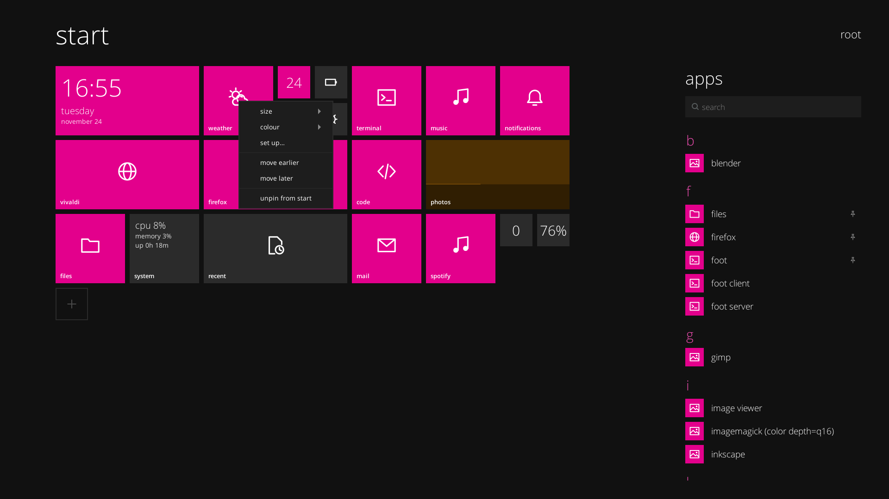
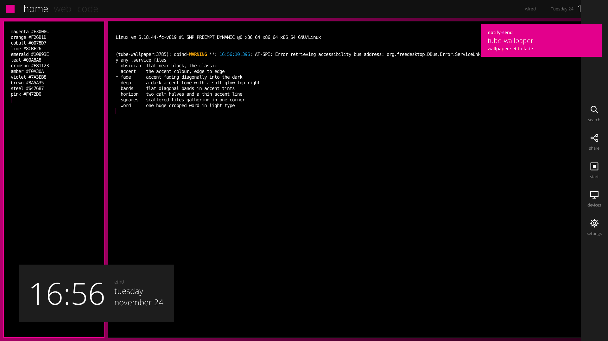
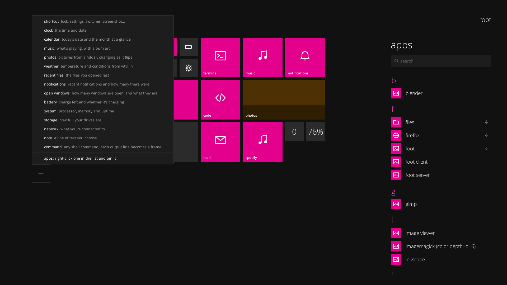
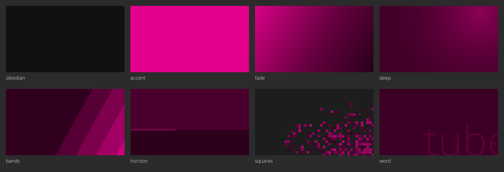

# tubewm desktop

A Sway desktop that borrows the *ideas* of Metro and the Zune player (big
lowercase type, pivots, flat colour tiles, one accent colour, content over
chrome) with its own glyphs, the open Open Sans font, and no borrowed
artwork.


| | |
|---|---|
|  |  |
|  |  |
|  |  |



## What's in it

| Piece | What it does | Built on |
|---|---|---|
| **Pivots** | Workspaces have lowercase names (`home`, `web`, `code`…) and the bar shows them as 30 px light headers: the current one white, the rest fading back. Three-finger swipes pan between them. | sway, waybar |
| **Start** | Full-screen tile grid that you arrange yourself: pin apps, add live tiles, drag, resize and recolour them. Every installed app is listed down the right-hand side, Zune style, with letter headers; type anywhere to filter it. | `tube-start` (Python + GTK 3 + gtk-layer-shell) |
| **Wallpapers** | Eight calm wallpapers drawn from the accent colour, redrawn whenever it changes. | `tube-wallpaper` (cairo) |
| **Charms** | Right-edge bar (search, share, start, devices, settings) with a big clock card bottom-left. Click anywhere else to dismiss. | `tube-charms` |
| **Settings flyout** | Accent swatches, wallpapers, volume, brightness, do-not-disturb, wi-fi, and power (restart / shut down ask twice). | `tube-charms --settings` |
| **Snap** | Dock the focused window as a 320 px column at either edge, press again for 500 px, then half. | `tube-snap` |
| **Switcher** | Every open window on every workspace in one flat list. | `tube-switcher` (fuzzel) |
| **Toasts** | Flat accent rectangles, top right, 380 px wide. Volume and brightness get their own small indicator, top left. | mako, `tube-osd` |
| **Lock** | Big clock curtain with gtklock if you have it, otherwise swaylock(-effects) in the same colours. | `tube-lock` |
| **Apps** | GTK 3/4 squared off and accent-coloured, foot terminal on a full-bleed black canvas, no title-bar buttons. | gtk.css, gsettings, foot |
| **Accent** | One command recolours everything above, plus any hooks in `~/.config/tubewm/accent.d/` (the VS Code and Vivaldi themes in `apps/` use this). | `tube-accent` |

## Install

```sh
git clone https://github.com/alex-ha-192/tubewm
cd tubewm
desktop/install.sh --deps          # --deps installs packages with apt, pacman, dnf or zypper
```

Then log into a sway session (or `swaymsg reload` if you're already in one).

* Everything goes into your home directory: the scripts to `~/.local/share/tubewm`
  with links in `~/.local/bin` (make sure that's on your `PATH`), configs to `~/.config`.
* Every config file it replaces is copied to `~/.config/tubewm/backup/<date>/` first.
* `desktop/install.sh --uninstall` removes it and restores the most recent backup.
* `--no-gsettings` leaves your GTK settings alone; `--accent teal` picks an accent.
* Re-run the installer after `git pull` to update. Your start tiles, accent and wallpaper are kept.

The [top-level README](../README.md#installation) has the full step-by-step guide,
including the VS Code and Vivaldi themes.

**Packages used:** sway, swaybg, swayidle, swaylock, waybar, fuzzel, mako, foot,
grim, slurp, wl-clipboard, jq, playerctl, brightnessctl, libnotify, wireplumber,
python3-gobject and pycairo with GTK 3 and gtk-layer-shell, Open Sans. Optional: gtklock
(nicer lock screen), pavucontrol, blueman, NetworkManager (`nmcli`), curl (weather tile).

## Keys

`Super` is the Windows / logo key.

| Keys | Action |
|---|---|
| `Super+S` | start (press again to close) |
| `Super+D` | start, with the app list focused |
| `Super+Q` | search apps |
| `Super+C` | charms |
| `Super+I` | settings flyout |
| `Super+Tab` | switch to any window |
| `Super+Return` | terminal |
| `Super+L` | lock |
| `Alt+F4` or `Super+W` | close window |
| `Super+,` / `Super+.` | snap left / right (again: wider) |
| `Super+/` | equal widths again |
| `Super+F` | full screen |
| `Super+V` | float / tile |
| `Super+T` | tabbed / split |
| `Super+R` | resize mode (arrows, Esc to leave) |
| `Super+Arrows` | move focus; add `Shift` to move the window |
| `Super+Ctrl+Left/Right` | previous / next pivot; add `Shift` to take the window along |
| `Super+1…0` | go to pivot; add `Shift` to send the window |
| `Super+Z` | hide / show the bar |
| `Super+Shift+E` | power options |
| `Print` / `Shift+Print` | screenshot screen / region (copied and saved) |
| 3 fingers ← → | previous / next pivot |
| 3 fingers ↑ / ↓ | start / switcher |
| 4 fingers ← / → | charms open / close |

Inside start: type to search the app list, `Esc` to clear the search or close,
`Alt+Arrows` to move the focused tile, `Menu` or `Shift+F10` for the focused
tile's menu, `Ctrl+P` to pin or unpin the focused app.

## Start

Start is a grid of tiles on the left and every installed app on the right.

* **Pin an app:** right-click it in the list (or focus it and press `Ctrl+P`) and
  choose *pin to start*. Pinned apps have a small pin mark.
* **Move a tile:** drag it. Dropping it on another tile takes that tile's place;
  dropping it in a gap puts it there. `Alt+Arrows` moves the focused tile.
* **Change a tile:** right-click it, or press and hold on a touchscreen. The menu
  has *size* (small, medium, wide, large, whichever the tile supports),
  *colour* (accent, dark, or one of the palette accents), *set up…* for tiles
  with options, *move earlier / later* and *unpin*.
* **Add a live tile:** press the **+** under your tiles and pick one.
* **Start over:** `tube-start --reset`, or the link in the settings flyout.

Your layout is saved to `~/.config/tubewm/start.json` as you go. New installs
start from `desktop/start/default.toml`; tiles for apps you don't have are
skipped. A `start.toml` from an older tubewm is converted the first time.

### Live tiles

| Tile | Shows | Set up |
|---|---|---|
| clock | the time and date | |
| calendar | today, or the month at large size | |
| weather | temperature and conditions from wttr.in, every 30 minutes | place |
| music | what's playing, with album art (any MPRIS player); click to play / pause | |
| photos | random pictures from a folder, turning over | folder |
| messages | your latest notifications | |
| recent | files you opened recently | |
| windows | how many windows are open and their titles | |
| battery | charge and charging state | |
| system | CPU, memory and uptime | |
| storage | how full your drives are | |
| network | the connection you're on | |
| note | a few words of your own; click to edit | text |
| command | the output of any shell command, line by line | command, interval, label |
| shortcut | lock, settings, charms, switcher, devices or screenshot | action |

Live tiles turn over the way the spec describes: one tile (sometimes two) every
4.5 to 7 seconds, with a 450 ms flip.

## Make it yours

* **Accent:** `tube-accent list`, `tube-accent cobalt`, `tube-accent '#1BA1E2'`,
  `tube-accent random`, or click a swatch in the settings flyout.
* **Start tiles:** arrange them in start itself (see [Start](#start)).
* **Wallpaper:** `tube-wallpaper list`, `tube-wallpaper horizon`, or pick one in the
  settings flyout. `tube-wallpaper off` goes back to the plain backdrop, so you
  can set your own picture in `~/.config/sway/config.d/`. The word style draws
  "tube" unless you set `TUBE_WALLPAPER_WORD`.
* **Pivot names:** the `$ws1`…`$ws10` lines at the top of `~/.config/sway/config`, and
  the matching `format-icons` in `~/.config/waybar/config.jsonc`.
* **Your own sway settings:** drop `*.conf` files in `~/.config/sway/config.d/`
  (e.g. `output * bg ~/Pictures/wall.png fill`, keyboard layout, monitor layout).
* **Your own CSS:** `~/.config/waybar/style.css` (below the import),
  `~/.config/tubewm/user.css` (start and charms), `~/.config/gtk-3.0/user.css`,
  `~/.config/gtk-4.0/user.css`.
* **Live tiles from scripts:** add a *command* tile, then *set up…* to give it a
  shell command and an interval in seconds. Each output line becomes a frame;
  use a tab to split a big title from smaller text, for example
  `df -h --output=pcent / | tail -n1 | sed 's/^ */disk\t/'`.

Generated files (the ones with colours in them) carry a "do not edit" header;
`tube-render` rewrites them whenever the accent changes.

## How it's put together

```
desktop/
  install.sh            installer / updater / uninstaller
  config/               installed once, then yours to edit
    sway/config
    waybar/config.jsonc, waybar/style.css
  templates/            rendered with the palette into ~/.config on every accent change
    sway/tubewm-colors, waybar/tubewm.css, mako/config, fuzzel/fuzzel.ini,
    foot/foot.ini, swaylock/config, gtklock/style.css, gtk-3.0/gtk.css, gtk-4.0/gtk.css
  bin/                  tube-* commands (bash, plus two Python entry points)
  shell/                the start screen, charms and wallpapers (Python, GTK 3, gtk-layer-shell, cairo)
    style.css           their stylesheet; colours are filled in at start-up
    tubewm_shell/       start.py, layout.py, tiles.py, charms.py, wallpaper.py, glyphs.py, common.py
  start/default.toml    the start layout new users get
../palette/             shared colours (also read by the apps/ themes)
```

Colours come from `palette/tubewm-colors.sh`: obsidian `#111111` for the shell,
charcoal `#1D1D1D` for surfaces, black `#000000` behind apps, white text,
grey `#8A8A8A` for secondary text, and the accent (magenta `#E3008C` by default).

## Notes against the spec

The Metro-WDM spec describes a purpose-built compositor. This is Sway plus
small tools instead, so a few things are approximated or left out:

* **Snapped / fill layouts** are real tiled columns with a 10 px gap rather than
  a 12 px splitter bar, and you can still split windows any way sway allows.
* **Live tiles** update by polling (clock, battery, `playerctl`, `/proc`, `makoctl`,
  wttr.in, or your own command) rather than through a D-Bus tile broker.
* **Background:** the Zune leaned on pure black; here the default wallpaper is a
  soft accent fade, with flat black (`obsidian`) one click away.
* **Hot corners** aren't available in sway; the same actions are on keys and
  touchpad gestures. Edge swipes on touchscreens aren't wired up.
* **Background suspension, direct scanout, and the custom `zmetro_shell_surface_v1`
  protocol** are compositor internals and out of scope here (sway already does
  direct scanout for full-screen windows).
* **Lock curtain:** a sliding curtain needs a lock client that supports it; gtklock
  gets closest, and swaylock is the fallback.
