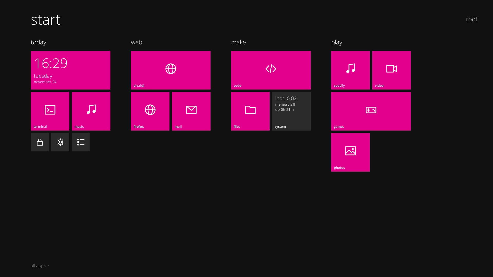
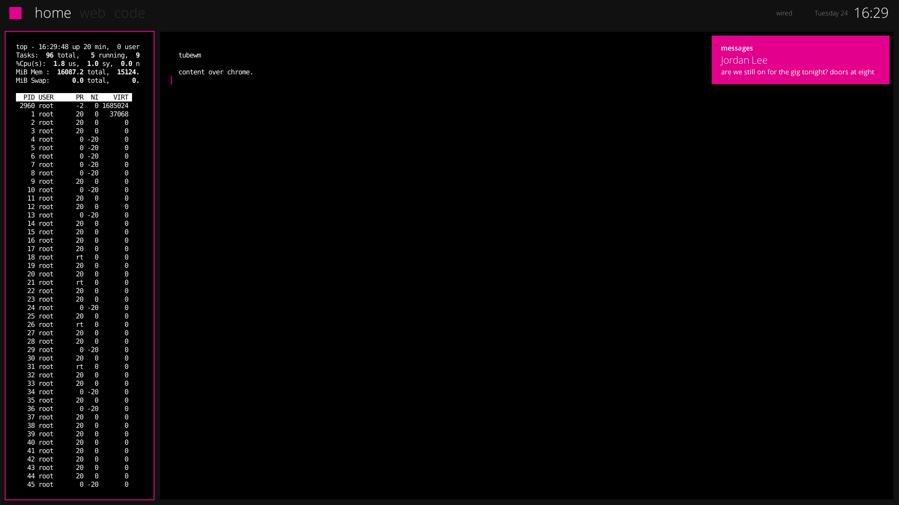
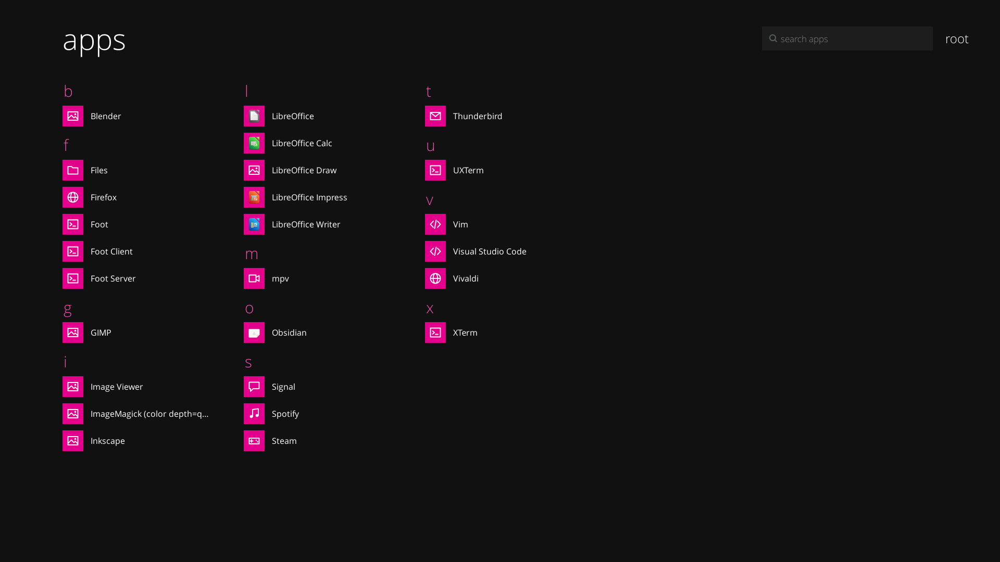
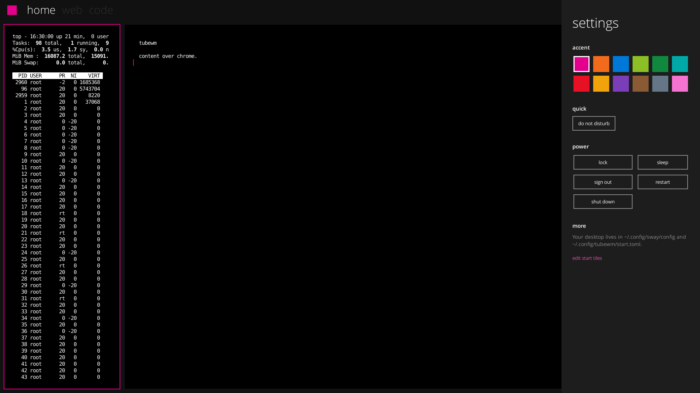
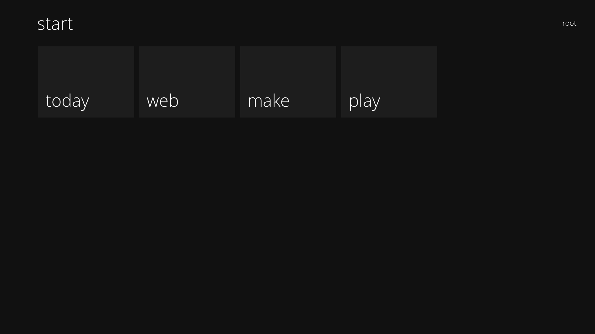
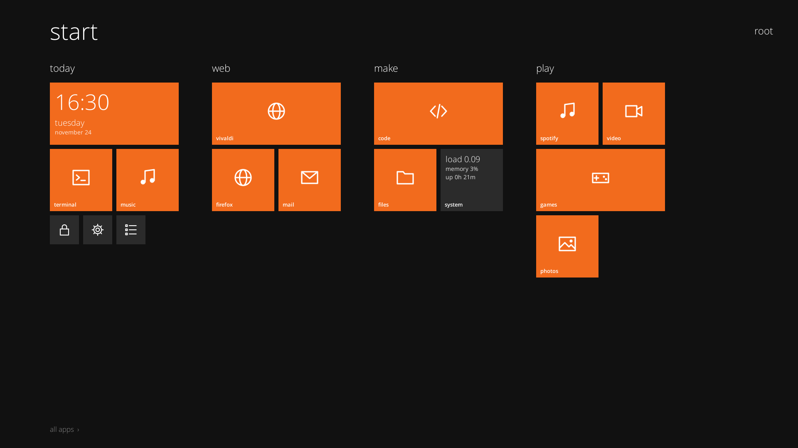

# tubewm desktop

A Sway desktop that borrows the *ideas* of Metro and the Zune player (big
lowercase type, pivots, flat colour tiles, one accent colour, content over
chrome) with its own glyphs, the open Open Sans font, and no borrowed
artwork.



| | |
|---|---|
|  |  |
|  |  |
|  |  |

## What's in it

| Piece | What it does | Built on |
|---|---|---|
| **Pivots** | Workspaces have lowercase names (`home`, `web`, `code`…) and the bar shows them as 30 px light headers: the current one white, the rest fading back. Three-finger swipes pan between them. | sway, waybar |
| **Start** | Full-screen panorama of tile groups that scrolls sideways. App tiles, live tiles (clock, battery, now playing, system, any command), and action tiles. Type anywhere to search. `Ctrl+-` zooms out to the group names. | `tube-start` (Python + GTK 3 + gtk-layer-shell) |
| **All apps** | Every installed app in alphabetical columns with letter headers, filtered as you type. | `tube-start --apps` |
| **Charms** | Right-edge bar (search, share, start, devices, settings) with a big clock card bottom-left. Click anywhere else to dismiss. | `tube-charms` |
| **Settings flyout** | Accent swatches, volume, brightness, do-not-disturb, wi-fi, and power (restart / shut down ask twice). | `tube-charms --settings` |
| **Snap** | Dock the focused window as a 320 px column at either edge, press again for 500 px, then half. | `tube-snap` |
| **Switcher** | Every open window on every workspace in one flat list. | `tube-switcher` (fuzzel) |
| **Toasts** | Flat accent rectangles, top right, 380 px wide. Volume and brightness get their own small indicator, top left. | mako, `tube-osd` |
| **Lock** | Big clock curtain with gtklock if you have it, otherwise swaylock(-effects) in the same colours. | `tube-lock` |
| **Apps** | GTK 3/4 squared off and accent-coloured, foot terminal on a full-bleed black canvas, no title-bar buttons. | gtk.css, gsettings, foot |
| **Accent** | One command recolours everything above, plus any hooks in `~/.config/tubewm/accent.d/` (the VS Code and Vivaldi themes in `apps/` use this). | `tube-accent` |

## Install

```sh
git clone https://github.com/alex-ha-192/tubewm
cd tubewm
desktop/install.sh --deps          # --deps installs packages with apt, pacman, dnf or zypper
```

Then log into a sway session (or `swaymsg reload` if you're already in one).

* Everything goes into your home directory: the scripts to `~/.local/share/tubewm`
  with links in `~/.local/bin` (make sure that's on your `PATH`), configs to `~/.config`.
* Every config file it replaces is copied to `~/.config/tubewm/backup/<date>/` first.
* `desktop/install.sh --uninstall` removes it and restores the most recent backup.
* `--no-gsettings` leaves your GTK settings alone; `--accent teal` picks an accent.
* Re-run the installer after `git pull` to update. Your start tiles and accent are kept.

**Packages used:** sway, swaybg, swayidle, swaylock, waybar, fuzzel, mako, foot,
grim, slurp, wl-clipboard, jq, playerctl, brightnessctl, libnotify, wireplumber,
python3-gobject with GTK 3 and gtk-layer-shell, Open Sans. Optional: gtklock
(nicer lock screen), pavucontrol, blueman, NetworkManager (`nmcli`).

## Keys

`Super` is the Windows / logo key.

| Keys | Action |
|---|---|
| `Super+S` | start (press again to close) |
| `Super+D` | all apps |
| `Super+Q` | search apps |
| `Super+C` | charms |
| `Super+I` | settings flyout |
| `Super+Tab` | switch to any window |
| `Super+Return` | terminal |
| `Super+L` | lock |
| `Alt+F4` or `Super+W` | close window |
| `Super+,` / `Super+.` | snap left / right (again: wider) |
| `Super+/` | equal widths again |
| `Super+F` | full screen |
| `Super+V` | float / tile |
| `Super+T` | tabbed / split |
| `Super+R` | resize mode (arrows, Esc to leave) |
| `Super+Arrows` | move focus; add `Shift` to move the window |
| `Super+Ctrl+Left/Right` | previous / next pivot; add `Shift` to take the window along |
| `Super+1…0` | go to pivot; add `Shift` to send the window |
| `Super+Z` | hide / show the bar |
| `Super+Shift+E` | power options |
| `Print` / `Shift+Print` | screenshot screen / region (copied and saved) |
| 3 fingers ← → | previous / next pivot |
| 3 fingers ↑ / ↓ | start / switcher |
| 4 fingers ← / → | charms open / close |

Inside start: type to search, `Esc` to go back or close, `Ctrl+-` to zoom out,
`Page Up/Down` or the mouse wheel to pan.

## Make it yours

* **Accent:** `tube-accent list`, `tube-accent cobalt`, `tube-accent '#1BA1E2'`,
  `tube-accent random`, or click a swatch in the settings flyout.
* **Start tiles:** `~/.config/tubewm/start.toml`. Every field is explained at the top of
  the file. Tiles for apps you don't have are hidden, so the default list
  lists alternatives side by side.
* **Pivot names:** the `$ws1`…`$ws10` lines at the top of `~/.config/sway/config`, and
  the matching `format-icons` in `~/.config/waybar/config.jsonc`.
* **Your own sway settings:** drop `*.conf` files in `~/.config/sway/config.d/`
  (e.g. `output * bg ~/Pictures/wall.png fill`, keyboard layout, monitor layout).
* **Your own CSS:** `~/.config/waybar/style.css` (below the import),
  `~/.config/tubewm/user.css` (start and charms), `~/.config/gtk-3.0/user.css`,
  `~/.config/gtk-4.0/user.css`.
* **Live tiles from scripts:** a `command` tile runs a shell command every `interval`
  seconds; each output line becomes a frame (use a tab to split title from text):

  ```toml
  { type = "command", size = "wide", label = "disk", interval = 300, command = '''df -h --output=target,pcent / | tail -n +2 | awk '{print $1 "\t" $2 " used"}' ''' },
  ```

Generated files (the ones with colours in them) carry a "do not edit" header;
`tube-render` rewrites them whenever the accent changes.

## How it's put together

```
desktop/
  install.sh            installer / updater / uninstaller
  config/               installed once, then yours to edit
    sway/config
    waybar/config.jsonc, waybar/style.css
  templates/            rendered with the palette into ~/.config on every accent change
    sway/tubewm-colors, waybar/tubewm.css, mako/config, fuzzel/fuzzel.ini,
    foot/foot.ini, swaylock/config, gtklock/style.css, gtk-3.0/gtk.css, gtk-4.0/gtk.css
  bin/                  tube-* commands (bash, plus two Python entry points)
  shell/                the start screen and charms (Python, GTK 3, gtk-layer-shell)
    style.css           their stylesheet; colours are filled in at start-up
    tubewm_shell/       start.py, charms.py, tiles.py, glyphs.py, common.py
  start/start.toml      default start tiles
../palette/             shared colours (also read by the apps/ themes)
```

Colours come from `palette/tubewm-colors.sh`: obsidian `#111111` for the shell,
charcoal `#1D1D1D` for surfaces, black `#000000` behind apps, white text,
grey `#8A8A8A` for secondary text, and the accent (magenta `#E3008C` by default).

## Notes against the spec

The Metro-WDM spec describes a purpose-built compositor. This is Sway plus
small tools instead, so a few things are approximated or left out:

* **Snapped / fill layouts** are real tiled columns with a 10 px gap rather than
  a 12 px splitter bar, and you can still split windows any way sway allows.
* **Live tiles** update by polling (clock, battery, `playerctl`, `/proc`, or your own
  command) rather than through a D-Bus tile broker. The flip scheduler follows the
  spec: one tile (sometimes two) turns over every 4.5–7 s, with a 450 ms flip.
* **Hot corners** aren't available in sway; the same actions are on keys and
  touchpad gestures. Edge swipes on touchscreens aren't wired up.
* **Background suspension, direct scanout, and the custom `zmetro_shell_surface_v1`
  protocol** are compositor internals and out of scope here (sway already does
  direct scanout for full-screen windows).
* **Lock curtain:** a sliding curtain needs a lock client that supports it; gtklock
  gets closest, and swaylock is the fallback.
